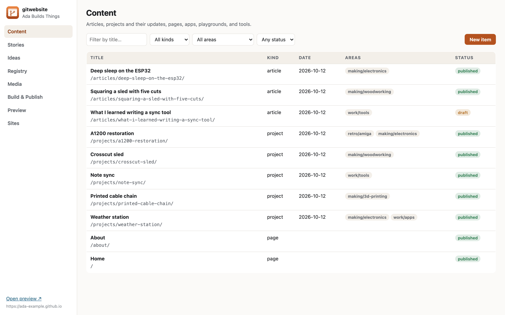
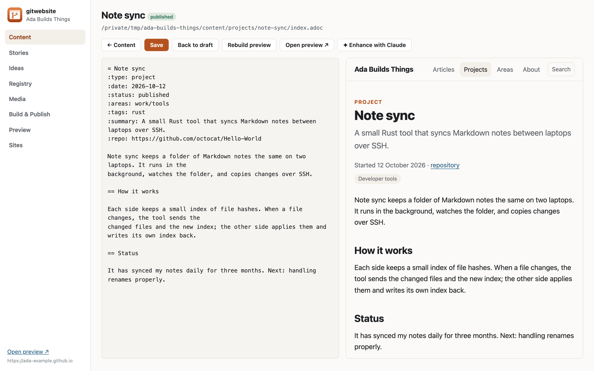
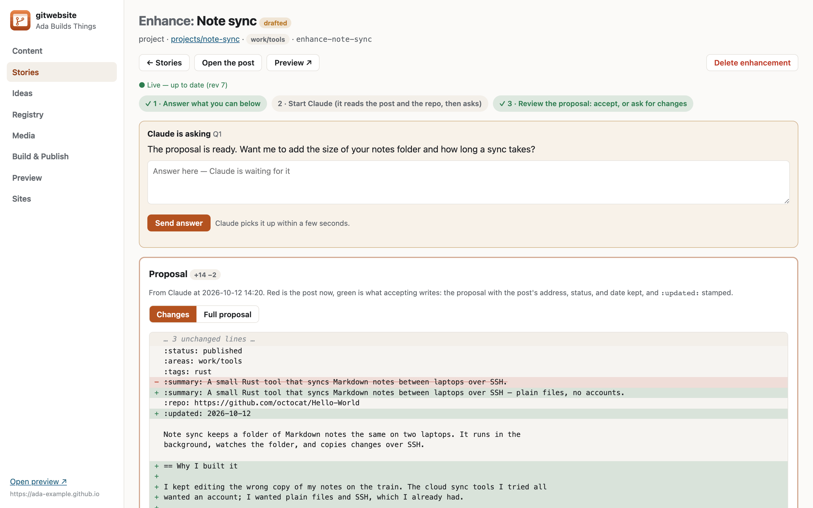
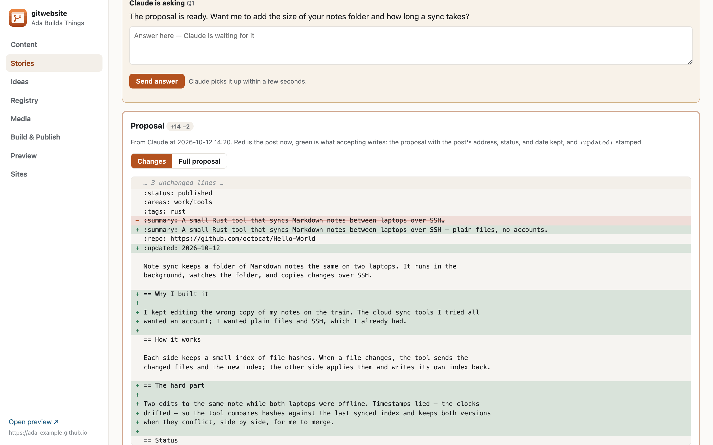
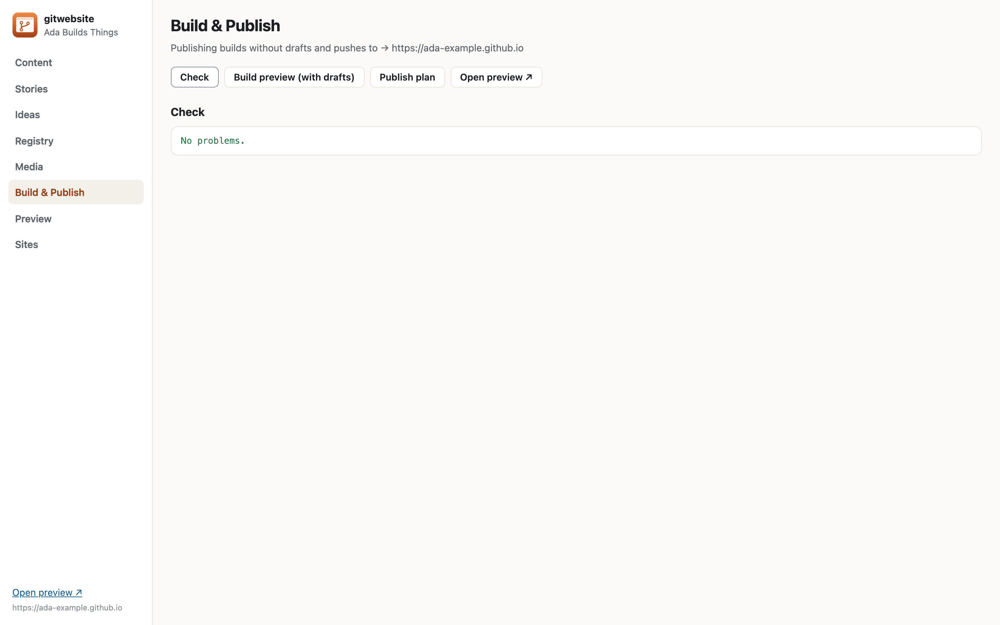
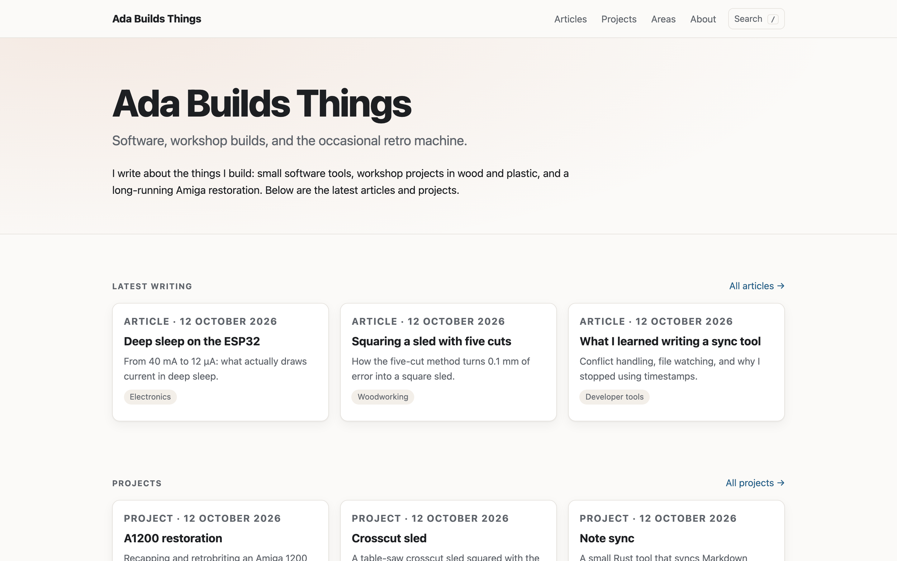
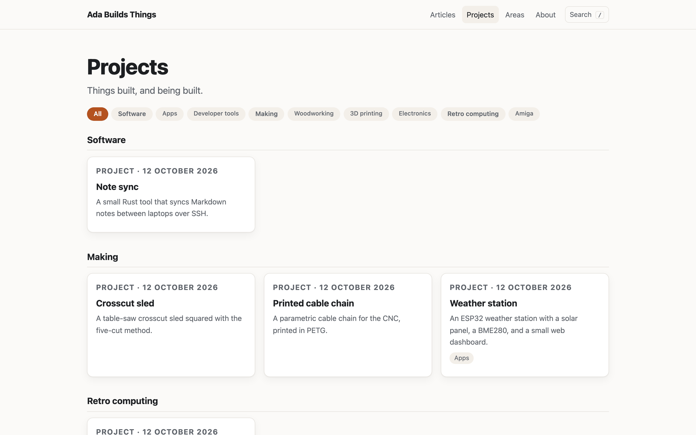

= gitwebsite

Build, curate, and publish a personal or project website from AsciiDoc kept in git — with a
desktop app, a command line, and Claude as a writing partner that can read the code your posts
are about.

* *One Rust core, four front ends*: the `gw` command line, a REST API with a browser UI, an
  MCP server for Claude and other AI assistants, and a native desktop app (Tauri).
* *An information architecture you edit as data*: overlapping areas you define in `site.yaml`,
  and kinds of content — articles, projects with dated updates, standing pages, live apps, and
  code playgrounds that run in the browser.
* *A projects page grouped by area*, with filter buttons that find every project in an area.
* *A default theme built in*: a new site needs no templates; override any one you like.
* *A provenance registry* of where everything came from (books, imported posts, photo albums,
  repositories) and an *ideas board* for what to share next.
* *Media from anywhere*: images beside the text, any URL, or a media library
  (`image::media:key[]`), optionally backed by SmugMug.
* *Safe publishing to GitHub Pages*: only the files gitwebsite built are ever written to the
  Pages repository; anything else that lives there is left alone.
* *Project stories*: drop in photos with a comment on each, and Claude interviews you and drafts
  the post.
* *Enhance with Claude*: open any post, answer a few key questions (inspiration, how it works,
  the hard parts…), and Claude reads the post and the repository behind it, asks follow-ups on
  the page, and proposes a revision you review as a diff.
* *Several sites*: switch between them in the app or with `gw config use`.
* Optional *WordPress* import and cross-posting.
* *Code catalog*: every git project at `/code/` — categories, search and tags like the tools page,
  a page per project with its logo, description and related projects. Synced from GitHub; text
  improved with Claude; missing logos as batches of ChatGPT prompts, imported back and added to
  each repository's README by pull request.
* *Meshy models*: keeps a git repository of your Meshy.ai 3D models in step with your account —
  a free scheduled sync in the app, a Models page with every view and README, and paid recovery of
  expired models only when you confirm the credits.

== Screenshots

The app, running against a demo site made with `gw init`.

.Content: every article, project, and page, with its areas and status

.Editing a post beside a live preview

.Enhance with Claude: Claude asks on the page; answer there

.The proposal as a diff against the post, to accept, discard, or send back

.Check, preview, and publish

.The default theme: home page and the projects page grouped by area

== Quick start

You need Rust (stable), Ruby with the `asciidoctor` gem, and git. The desktop app also needs
the Tauri CLI (`cargo install tauri-cli --version "^2"`); WordPress import needs pandoc.

[source,console]
----
git clone https://github.com/geekychris/gitwebsite && cd gitwebsite
make install          # gw → ~/.local/bin, Claude skills, gitwebsite.app → ~/Applications

gw init ~/sites/notes --title "My notes" --author "Mona Octocat" \
    --pages-repo octocat/octocat.github.io --git
cd ~/sites/notes
gw serve --open       # management UI + live preview at http://127.0.0.1:8790/app/
gw new article "My first post" --area notes
gw check
gw publish --dry-run
gw publish            # asks before committing and pushing to the live site
----

Or open the app: on first run it offers to open an existing site or create a new one.

To give Claude Code the site's tools: `claude mcp add --scope user gitwebsite -- gw mcp`.

== Documentation

All in `docs/` (AsciiDoc; `make docs` renders `docs/index.html`):

* link:docs/setup.adoc[Setting up] — install, `gw init`, several sites, settings, Claude Code
* link:docs/architecture.adoc[Architecture]
* link:docs/information-architecture.adoc[Information architecture] — what goes where, listing pages
* link:docs/authoring.adoc[Writing content] — headers, bundles, images, playgrounds, apps
* link:docs/stories.adoc[Project stories and Enhance with Claude]
* link:docs/publishing.adoc[Building, previewing, and publishing]
* link:docs/registry-and-ideas.adoc[Registry and ideas]
* link:docs/interfaces.adoc[Interfaces] — CLI, REST, MCP, desktop app, skills
* link:docs/integrations.adoc[Integrations] — SmugMug, WordPress, Meshy models and the code catalog (optional)
* link:docs/companion.adoc[The companion] — relays for the site's browser tools (HTTP, TCP, Docker, Kubernetes, git), pairing, tool windows, MCP `tool_open`
* link:docs/templates.adoc[Templates and layouts]

== Layout

[source]
----
crates/gw-core/   core library (content, build, publish, theme/)
crates/gw/        operations, CLI, REST, MCP, integrations
app/src-tauri/    desktop app            ui/       management UI
docs/             documentation          skills/   Claude Code skills
----

== Licence

MIT — see link:LICENSE[LICENSE]. Contributions welcome: link:CONTRIBUTING.adoc[CONTRIBUTING].
